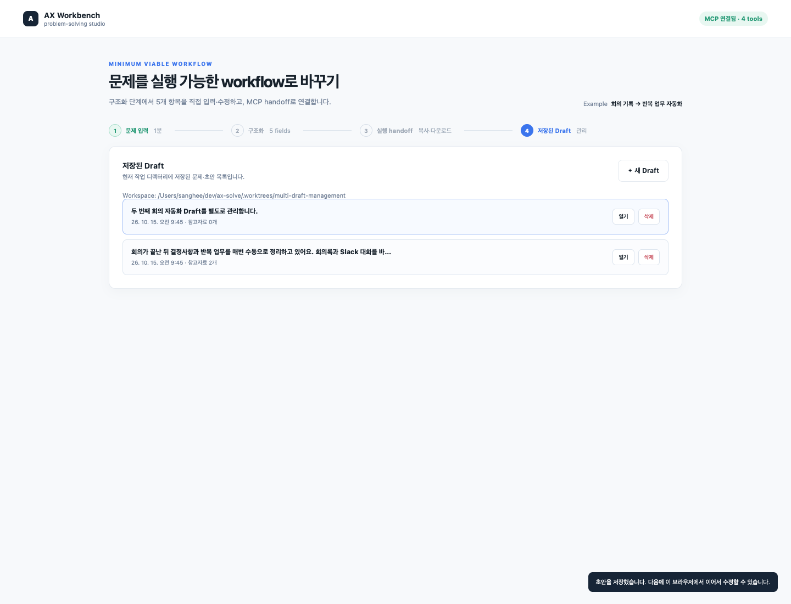

# AX Workbench

문제의 원문을 실행 가능한 workflow로 정리하되, 사람이 검토하기 전에는
외부 전송이나 업무 확정을 하지 않는 개인용 AX 문제 해결 워크벤치입니다.

## 현재 구현

`문제 입력 → 구조화 → 직접 수정 → 검증 → 검토용 handoff` 흐름을 제공하며, 저장된 Draft를 여러 개 관리할 수 있습니다.
`ax-workflow` Skill을 실행하면 로컬 MVP와 HTTP MCP를 먼저 확인·실행하고,
브라우저를 `127.0.0.1:8787`로 엽니다.

- 문제 문장과 참고자료 파일을 첫 단계에서 선택합니다. 선택한 파일의 이름과 내용이 handoff에 포함되며, 같은 이름의 파일은 절대경로를 추가할 수 있습니다.
- 구조화 단계에서 `Goal`, `Constraints`, `Success criteria`, `Anti-goals`,
  `Acceptance rubric`을 직접 수정합니다.
- 첫 단계의 원문과 참고자료(파일명·절대경로·내용)는 구조화 화면과 handoff 문서의 `Request`,
  `References`에 그대로 이어집니다.
- handoff는 Markdown·JSON으로 복사하거나 다운로드할 수 있습니다.
- 로컬 저장만 사용하며 로그인, 자동 메일, 업무 확정, 외부 업로드는 없습니다.
- 이전의 `work on meeting-summary` 실행 명령은 사용하지 않습니다.

## 기술 스택

외부 서비스 없이 로컬에서 동작하는 buildless MVP로 구성했습니다.

| 영역 | 기술 | 사용처 |
|---|---|---|
| 런타임·서버 | Node.js ES Modules, Node 표준 라이브러리 | 정적 MVP 서버와 HTTP MCP endpoint, plugin용 stdio MCP |
| UI | HTML, CSS, Vanilla JavaScript | 문제 입력, 5-field 직접 수정, handoff, Draft 관리 화면 |
| 브라우저 API | Fetch, File API, `localStorage` | MCP 호출, HTML/YAML 참고자료 입력, Workspace별 Draft 저장 |
| MCP | Model Context Protocol, JSON-RPC 기반 HTTP·stdio transport | 참고자료 변환, 구조화, 검증, handoff 생성 도구 |
| 변환 | 자체 HTML/YAML → Markdown 변환기 | `ax_read_reference`의 참고자료 Markdown 변환 |
| Plugin | Claude Code·Codex 호환 manifest와 Skill | 동일 workflow를 Claude Code와 Codex에서 실행 |
| 테스트 | Node `node:test`, Python `pytest`, Playwright | Unit·Integration·Plugin·E2E 검증과 화면 캡처 |
| 문서·증거 | Markdown, PNG | 기능 설명, 실행 방법, 상태별 UI 스크린샷 |

별도 프론트엔드 빌드 도구나 런타임 npm dependency는 사용하지 않습니다.

## ax-solve의 정의

`ax-solve`는 Claude Code와 Codex에서 **어떤 문제를 풀 것인지 먼저 명세하도록 돕는 plugin**입니다.
문제 원문과 참고자료를 `Goal`, `Constraints`, `Success criteria`, `Anti-goals`,
`Acceptance rubric`의 5-field 계약으로 정리하고, 사용자가 직접 수정·검증한 뒤
사람이 검토할 수 있는 `review-only` handoff 문서를 만듭니다.

ax-solve의 책임은 문제를 명확하게 정의하고 실행 조건을 합의 가능한 형태로 만드는 데
있습니다. 메일 발송, 외부 업로드, 업무 확정처럼 실제 실행에 해당하는 동작은 범위에
포함하지 않습니다.

## 문제 정의

AI에게 업무를 맡기기 전 단계에는 다음 문제가 반복됩니다.

| 문제 | ax-solve가 만드는 결과 |
|---|---|
| 요청이 모호해 무엇을 해결해야 하는지 불분명함 | 한 문장의 문제 원문과 `Goal`로 해결 대상을 고정 |
| 참고자료가 여러 형식과 위치에 흩어져 있음 | HTML·YAML·텍스트를 Markdown으로 통일하고 출처·절대경로를 보존 |
| 성공 여부와 하지 말아야 할 일이 암묵적임 | `Success criteria`, `Anti-goals`, `Acceptance rubric`으로 명시 |
| AI가 만든 초안을 검토·수정하기 어려움 | 5-field를 직접 수정하고 누락 필드를 검증 |
| 합의 전 실행되거나 결과가 추적되지 않음 | 실행하지 않는 `review-only` handoff와 Workspace별 Draft 저장 |

즉, ax-solve는 “AI가 바로 실행하도록 지시하는 도구”가 아니라
“사람과 AI가 같은 문제를 보고 있는지 확인하는 명세 도구”입니다.

## Acceptance Criteria

다음 조건을 모두 만족하면 현재 MVP의 핵심 기능이 완료된 것으로 봅니다.

- **AC-01 문제 입력:** 사용자가 문제 원문과 참고자료를 입력·선택할 수 있다.
- **AC-02 자료 정규화:** HTML·YAML 참고자료가 Markdown으로 변환되고, 변환된 본문을 사용자가 직접 수정할 수 있다.
- **AC-03 출처 보존:** 참고자료의 파일명·내용·사용자가 승인한 절대경로가 구조화 화면과 handoff의 `References`에 유지된다.
- **AC-04 직접 수정:** 사용자가 5개 계약 필드를 모두 수정할 수 있고, MCP 초안은 확정값으로 취급되지 않는다.
- **AC-05 검증 차단:** 필수 필드가 비어 있으면 handoff 생성을 진행할 수 없다.
- **AC-06 검토 문서:** handoff에 `Request`, `References`, `Contract`, `Verification`, `review-only` 상태가 포함된다.
- **AC-07 Draft 관리:** 같은 Workspace에서 여러 Draft를 저장·열기·삭제할 수 있고, 새로고침 후에도 저장된 상태를 복원한다.
- **AC-08 실행 경계:** 로그인, 외부 업로드, 자동 메일, 업무 확정 같은 외부 실행을 하지 않는다.
- **AC-09 호환성:** 동일한 workflow를 Claude Code와 Codex plugin에서 사용할 수 있다.

화면 상태별 증거와 테스트 매핑은 [기능 명세와 화면 증거](#기능-명세와-화면-증거)에 기록합니다.

## localhost 실행

프로젝트 루트에서 다음을 실행합니다.

```bash
node apps/workbench/mcp/server.mjs
```

브라우저:

- [MVP](http://127.0.0.1:8787/apps/workbench/demo/mvp.html)

기존 HTTP MCP endpoint는 `POST http://127.0.0.1:8787/mcp`입니다. 자세한 화면,
캡처, 테스트 설명은 [demo README](./apps/workbench/demo/README.md)를 참고합니다.

## Claude Code·Codex 호환 plugin

플러그인은 [plugins/ax-workbench](./plugins/ax-workbench)에 있습니다. `dev-kit`의
공통 구조처럼 Claude Code와 Codex가 같은 `skills/`를 사용하고, 클라이언트별
manifest/MCP 연결 파일만 분리했습니다.

```text
plugins/ax-workbench/
├── plugin.json                  # Agent Plugins portable manifest
├── mcp.json                     # Codex/Agent Plugins stdio MCP
├── .mcp.json                    # Claude Code MCP connection
├── .codex.mcp.json              # Codex compatibility MCP connection
├── .claude-plugin/plugin.json   # Claude Code manifest
├── .codex-plugin/plugin.json    # Codex compatibility manifest
├── mcp/
│   ├── contract.mjs
│   └── server.mjs
└── skills/
    ├── ax-workflow/SKILL.md
    └── setup/SKILL.md
```

제공하는 MCP 도구는 네 가지입니다.

- `ax_read_reference`: 사용자가 승인한 절대경로 또는 업로드 HTML/YAML을 읽고 Markdown으로 변환
- `ax_structure_problem`: 문제 원문과 참고자료를 5-field 초안으로 구조화
- `ax_validate_contract`: 직접 수정한 계약의 누락 필드 검증
- `ax_create_handoff`: Request·References·Contract·Verification을 포함한
  `review-only` handoff 생성

### Claude Code에서 로컬로 확인

```bash
claude --plugin-dir ./plugins/ax-workbench
```

Claude Code 세션에서 `/reload-plugins` 후 `/mcp`를 실행하면 plugin MCP 연결을
확인할 수 있습니다. 워크플로우 skill은 `/ax-workbench:ax-workflow`로 노출됩니다.

Skill을 사용하면 다음 순서로 진행합니다.

```text
localhost MVP/MCP 확인 → 원문 입력 → ax_structure_problem → 5-field 직접 수정
→ ax_validate_contract → ax_create_handoff → 사람 검토
```

Skill은 `apps/workbench/mcp/server.mjs`가 있는 프로젝트 루트에서만 localhost
MVP를 자동으로 열며, `scripts/ax-workbench-local.mjs`가 서버 재사용·detached
실행·MCP discovery·브라우저 열기를 담당합니다. 서버는 `127.0.0.1`에만
바인딩합니다. 프로젝트 파일이 없으면 plugin의 stdio MCP만 사용하고 경로를
추측하지 않습니다.

직접 호출이 필요한 경우에는 bundled MCP tool을 사용합니다. Claude Code에서는
plugin namespace가 붙어 보일 수 있으므로 `/mcp`에 표시된 실제 tool 이름을
확인합니다.

### Codex에서 로컬 plugin으로 확인

이 저장소에는 재현 가능한 local marketplace가 포함되어 있습니다.

```bash
codex plugin marketplace add .
codex plugin add ax-workbench@ax-solve-local
codex plugin marketplace list
```

저장소 루트에서 위 명령을 실행하면 `.agents/plugins/marketplace.json`을
기반으로 하는 `AX Solve Local` local marketplace가 등록되고 plugin이 설치됩니다.
또는 Codex 데스크톱의 Plugins 화면에서 `AX Solve Local`을 열어 `ax-workbench`를
설치한 뒤 새 세션을 시작합니다. 프로젝트별로 활성화하려면 `.codex/config.toml`에
다음을 추가합니다.

```toml
[plugins."ax-workbench@ax-solve-local"]
enabled = true
```

portable `plugin.json`·`mcp.json`과 `.codex-plugin`·`.codex.mcp.json` 호환
파일을 함께 제공하므로 최신 portable 경로와 호환 경로를 모두 보존합니다.

이 plugin은 로컬 stdio MCP를 사용하므로 실행 중인 웹 서버와 독립적으로 Codex와
Claude Code에서 동일한 구조화·검증·handoff 도구를 제공합니다.

## 테스트

```bash
npm test
```

현재 테스트 범위:

- Unit: 계약 생성·검증·handoff 값 보존
- Integration: 기존 HTTP MCP discovery와 UI 제공
- Plugin: portable/Claude/Codex manifest, skill, stdio MCP handshake와 tool 호출
- E2E: 문제 입력 → 구조화 원문 연결 → 직접 수정 → handoff → 빈 필드 차단

E2E가 완료되면 [screenshots](./apps/workbench/demo/screenshots/)도 다시 생성합니다.

## 기능 명세와 화면 증거

화면 캡처는 [apps/workbench/demo/screenshots](./apps/workbench/demo/screenshots)에
저장되며, 아래 명세의 각 상태를 재현합니다.

| 상태 | 화면 증거 | 기능 명세 | 통과 조건 |
|---|---|---|---|
| 1. 문제 입력 | [01-input-stage.png](./apps/workbench/demo/screenshots/01-input-stage.png) | 문제를 한 문장으로 입력하고 참고자료 파일을 선택한다. | 15자 미만이면 구조화하지 않고 입력 오류를 보여준다. |
| 2. 구조화·직접 수정 | [02-structured-editing.png](./apps/workbench/demo/screenshots/02-structured-editing.png) | Step 1의 원문·참고자료를 확인하면서 5개 계약 필드를 수정한다. | 원문과 참고자료의 이름·내용이 상단 컨텍스트 및 handoff preview에 유지된다. |
| 3. handoff 승인 | [03-handoff-ready.png](./apps/workbench/demo/screenshots/03-handoff-ready.png) | 모든 필드 검증 후 사람이 검토할 handoff를 준비한다. | `Ready`, `review-only`, `Request`, `References`, `Verification`이 포함된다. |
| 4. 저장된 Draft 관리 | [04-saved-drafts.png](./apps/workbench/demo/screenshots/04-saved-drafts.png) | 작업 디렉터리별로 여러 Draft를 저장하고 열거나 삭제한다. | Workspace 경로와 2개 이상의 Draft가 목록에 표시된다. |

### 화면 미리보기

#### 1. 문제 입력


#### 2. 구조화·직접 수정


#### 3. handoff 승인


#### 4. 저장된 Draft 관리



### 기능별 동작

| 기능 | 동작 | 데이터 경계 |
|---|---|---|
| 문제 입력 | 현재 작업 디렉터리별 Draft 목록에 초안을 저장하고 구조화 단계로 전달 | 외부 업로드 없음 |
| 구조화 | MCP가 초안을 만들고 사용자가 직접 편집 | MCP 초안은 확정값이 아님 |
| 검증 | 5개 필드가 비어 있는지 확인 | 누락 시 handoff 버튼 차단 |
| handoff | Markdown·JSON 복사/다운로드 | 자동 실행·메일·업무 확정 없음 |
| plugin skill | 동일한 Request·References·Contract workflow를 Claude Code/Codex에서 안내 | 검토용 문서만 생성 |

## 향후 개선 방향

현재 plugin은 로컬 검토 workflow MVP입니다. 다음 순서로 확장합니다.

1. **근거 추적성 강화:** 참고자료의 섹션·줄·변환 전후를 handoff에 연결해 각 판단의 근거를 확인한다.
2. **Draft 이력과 비교:** Draft 버전, 변경 diff, 복구 기능을 추가해 수정 과정과 합의 시점을 보존한다.
3. **실제 provider adapter:** Claude/Codex의 모델 호출을 선택적으로 연결하되, 구조화·검증·handoff 경계를 유지한다.
4. **workflow 산출물 연결:** 검토가 끝난 계약에서 Archify diagram, acceptance checklist, 실행 계획을 생성한다.
5. **권한·보안 강화:** 절대경로 접근 허용 목록, 민감정보 마스킹, 파일 크기·형식 정책을 제공한다.
6. **팀 협업과 CI:** 승인된 handoff만 Git issue/PR과 연결하고, 모든 외부 변경은 명시적 사용자 승인을 거치게 한다.

## 참고한 plugin 형식

- [Claude Code plugin overview](https://code.claude.com/docs/en/plugins)
- [Claude Code plugin components](https://code.claude.com/docs/en/plugins/components)
- [OpenAI plugin packaging](https://developers.openai.com/plugins/build/plugins)
- [OpenAI local MCP plugin](https://developers.openai.com/plugins/deploy/desktop-only)
