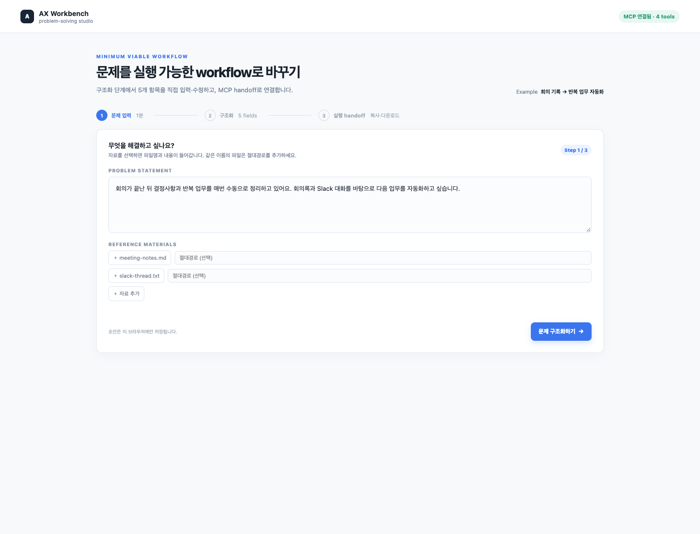
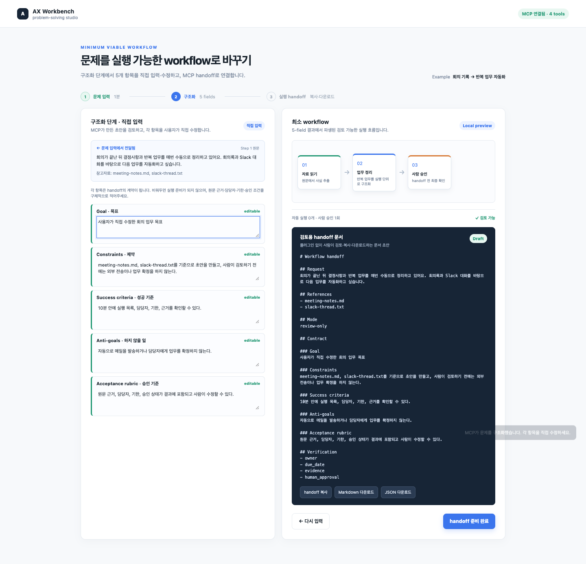
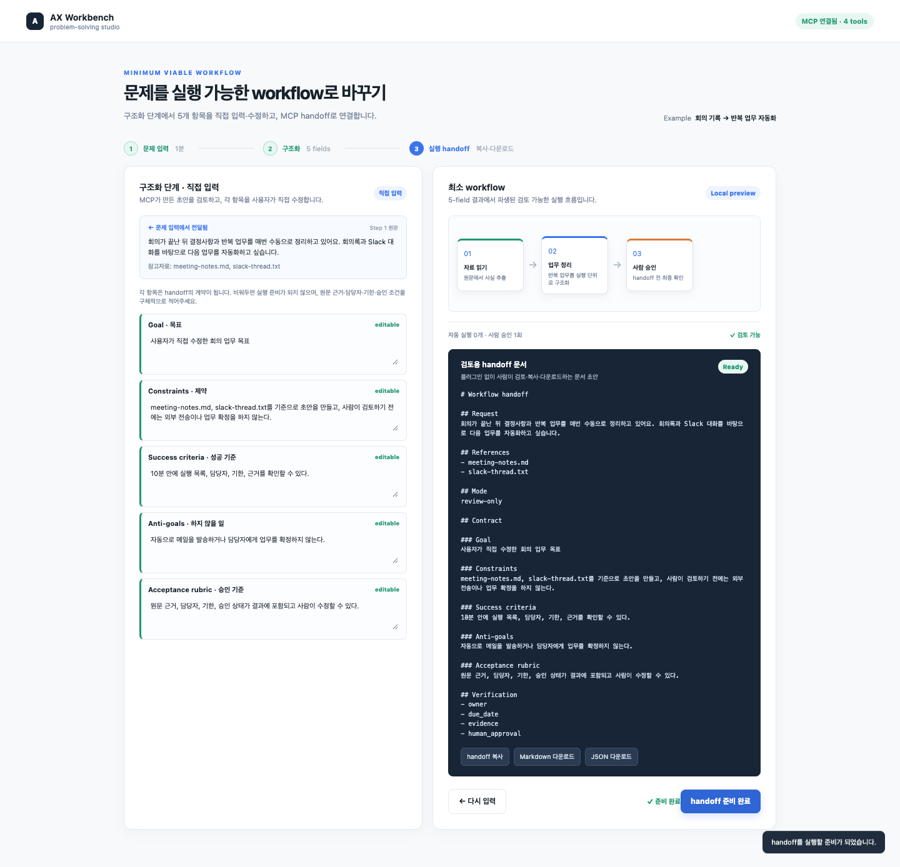

# AI Workbench UI Workflow Mockup

이 폴더는 `AI 업무 해결 워크벤치`의 첫 번째 UI workflow를 검증하기 위한
buildless HTML mockup이다.

로그인 없이 핵심 흐름만 확인하려면 [MVP](./mvp.html)를 연다. 구조화 단계에서
Goal, Constraints, Success criteria, Anti-goals, Acceptance rubric을 사용자가
직접 입력·수정할 수 있고, 로컬 MCP 서버가 연결되면 같은 5-field 계약을
구조화·검증·검토용 handoff 문서 생성에 사용한다. 웹 MVP에서는 플러그인 실행
명령을 사용하지 않고 검토용 문서만 생성한다. Claude Code/Codex 호환 plugin은
프로젝트 루트의 [plugins/ax-workbench](../../plugins/ax-workbench)에 별도로
제공하며, MCP가 없을 때는 브라우저 내부의 local fallback으로 동작한다.

플러그인 설치·Skill 사용법과 기능별 명세는 프로젝트 루트의
[README](../../README.md#claude-codecodex-%ED%98%B8%ED%99%98-plugin)를 참고한다.

문제 입력 단계의 원문과 참고자료(파일명·절대경로·내용)는 구조화 단계 상단에 전달되고,
같은 값이 검토용 handoff의 `Request`·`References`에 다시 포함된다. 파일 내용은
브라우저에서 읽고, 절대경로는 사용자가 직접 입력한 경우에만 로컬 MCP 또는 로컬 fallback handoff에 전달된다.

## 실행

브라우저에서 [index.html](./index.html)을 연다.

```bash
open apps/workbench/demo/index.html
```

최소 MVP 화면만 열기:

```bash
open apps/workbench/demo/mvp.html
```

## MCP 연결 실행

MCP까지 연결해 확인하려면 프로젝트 루트에서 다음을 실행한다.

```bash
node apps/workbench/mcp/server.mjs
```

그 다음 브라우저에서 아래 주소를 연다.

```text
http://127.0.0.1:8787/apps/workbench/demo/mvp.html
```

서버는 정적 MVP와 `POST /mcp`를 함께 제공한다. 제공하는 도구는 다음 네 가지다.

- `ax_read_reference`: 사용자가 승인한 절대경로 또는 업로드 HTML을 읽고 Markdown으로 변환
- `ax_structure_problem`: 문제와 참고자료를 5-field 초안으로 구조화
- `ax_validate_contract`: 사용자가 직접 수정한 5-field 계약 검증
- `ax_create_handoff`: 검토된 계약을 Markdown handoff 문서로 생성

브라우저 상단에 `MCP 연결됨`이 보이면 UI가 MCP를 사용하고 있는 상태다.
`Local fallback`이면 서버 없이도 직접 입력·수정 흐름은 계속 검증할 수 있다.

## 화면 캡처

테스트가 검증하는 세 가지 핵심 상태를 캡처해 저장했다.

### 1. 문제 입력



### 2. 구조화 단계 직접 수정



### 3. Handoff 승인 완료



## 테스트 실행

```bash
npm run test:unit
npm run test:integration
npm run test:e2e
npm test
```

현재 검증 범위는 다음과 같다.

- Unit: 계약 초안, 누락 필드 검증, 직접 수정값 보존, handoff readiness
- Integration: MCP discovery, 3개 tool 호출, 정적 MVP와 MCP endpoint 동시 제공
- E2E: 브라우저 MCP 연결, 구조화 단계 직접 입력·수정, handoff 승인, 빈 필드 차단

`npm run test:e2e`와 `npm test`는 E2E 검증 후 screenshot도 다시 생성한다.
화면 캡처만 다시 만들려면 다음을 실행한다.

```bash
python3 tests/e2e/capture_screenshots.py
```

## 예제 시나리오

회의록·Slack 대화·기존 양식에 흩어진 반복 업무를 찾아 자동화 workflow로
전환한다.

`Request → Frame → Map workflow → Handoff → Verify` 순서로 진행하며, 현재
화면은 세 번째 단계인 `Map workflow`를 중심으로 보여준다.

## 화면에서 검증하는 것

- 사용자가 구조화 단계에서 5-field를 직접 입력·수정할 수 있는가
- 5-field 문제정의가 workflow의 입력이 되는가
- workflow node를 선택했을 때 입력·출력·승인 조건을 이해할 수 있는가
- 문제 입력의 원문·참고자료가 구조화 단계와 검토용 handoff까지 이어지는가
- 자료가 부족할 때 자동 실행하지 않고 follow-up 질문으로 돌아가는가
- 결과물이 problem brief, diagram, handoff, acceptance checklist로 분리되는가

## 현재 구현 상태와 다음 단계

완료:

1. 5-field 직접 입력·수정 UI
2. local MCP 구조화·검증·handoff 연결
3. unit/integration/e2e 테스트와 screenshot 회귀 증거

다음 단계:

1. 실제 Claude/Codex provider adapter 연결
2. Archify diagram exporter 연결
3. Git 저장소와 CI가 있는 환경에서 실제 PR build/babysit/ship 실행
